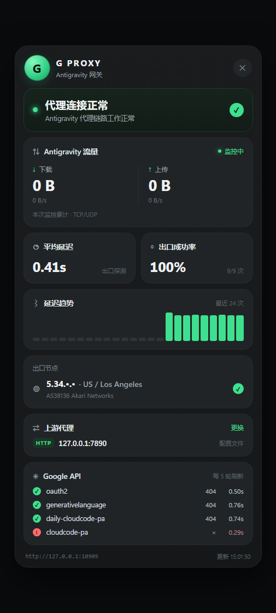

# G PROXY · Antigravity 网关

轻量的 Antigravity 一键启动器：自动探测本机代理，为 Antigravity 注入代理配置并启动，同时用一个本地可观测网关实时监控链路。

<p align="center"></p>

- **跨平台**：Windows / macOS（同一份 Go 代码，无运行时依赖，单文件约 10 MB）
- **双击即用**：桌面图标启动，自动拉起 Antigravity 并弹出监控面板
- **可观测**：链路状态、上下行流量与速率、延迟趋势、出口成功率、掩码后的出口节点、Google API 四接口可达性
- **可切换上游**：扫描本机正在跑的代理端口直接点选，也能手填地址，切换即时生效

## 界面能力

| 面板 | 数据来源 |
| --- | --- |
| 代理连接正常 / 异常 | 每轮经代理探测 `google.com/generate_204`，连续 3 次失败才判定异常 |
| Antigravity 流量（下载/上传 + 速率） | 本地网关逐字节统计，探针流量不计入 |
| 平均延迟 / 出口成功率 | 最近 24 次采样均值 + 累计成功次数 |
| 延迟趋势（24 柱） | 每次探测一个柱，失败显示为暗红色矮柱 |
| 出口节点 | 经链路查询 `ipinfo.io`，IP 最后两段打码，展示国家/城市/ASN |
| Google API 四接口 | oauth2 / generativelanguage / daily-cloudcode-pa / cloudcode-pa，每 5 轮刷新，404 视为可达 |
| 上游代理（可切换） | 扫描本机常见代理端口并逐个握手验证，点选即切换；也可手动填 `host:port` 或只填端口 |
| 页脚 | 本地网关地址、最后更新时间 |

## 切换上游代理

面板里「上游代理」卡片 → **更换**：

- 自动扫描本机正在监听的代理端口（Clash / Clash Verge / v2rayN / Surge / sing-box / Mihomo / ClashX / ShadowsocksX-NG 等），并标注「可用 / 未通过」——未通过代表端口开着但不能转发流量；
- 点任意一行即切换，切换前会用一次真实 TCP 握手验证，失败会提示原因并保持原配置；
- 也可以手动输入：`127.0.0.1:7890`、`7890`（等价 `127.0.0.1:7890`）、`localhost:1080`；
- 「切换为直连」清空上游。

切换后**立即生效**（新连接走新上游，已建立的连接不受影响），同时写回 `config.json`，下次启动沿用。扫描永远跳过网关自己的端口，不会出现自己代理自己的死循环。

## 快速开始

### Windows

```powershell
.\build.ps1 -Install
```

做三件事：把 `agy.exe`（控制台版）和 `agyw.exe`（无窗口版）装到 `%LOCALAPPDATA%\Programs\AgyProxy`，把该目录写入**用户 PATH**（`REG_EXPAND_SZ` 原样保留，不会破坏 `%USERPROFILE%` 这类变量），并在桌面创建 **G Proxy** 快捷方式（指向 `agyw.exe`）。

装完之后，任意新开的 cmd / PowerShell 里都能直接用：

```bash
agy                                    # 启动网关 + Antigravity + 监控窗口
agy -upstream http://127.0.0.1:7890    # 指定上游
agy -version
```

> PATH 是写进注册表的，**已经开着的 cmd 窗口读不到**，新开一个即可。

### macOS

```bash
chmod +x build.sh && ./build.sh --install
```

生成 `dist/agyproxy-darwin-<arch>`，把 `agy` 装到 `~/.local/bin`，并生成 **G Proxy.app**（双击即可，不会弹出终端窗口；日志写到 `~/Library/Logs/agyproxy.log`）。若 `~/.local/bin` 不在 PATH 中，安装结束时会打印需要追加的 `export` 行——工具不会擅自修改你的 shell 配置。

### 命令行

安装后（或直接运行 `dist\agyproxy.exe`）：

```bash
agy                                        # 后台常驻启动，立即回到提示符
agy -upstream http://127.0.0.1:7890        # 指定上游
agy -upstream socks5://127.0.0.1:1080
agy -upstream direct                       # 不走代理，仅做流量与链路观测
agy -stop                                  # 停止后台实例
agy -fg                                    # 前台运行，日志打在终端里（Ctrl+C 退出）
agy -close                                 # 启动后关闭当前 cmd 窗口（会一并结束窗口里的其他任务）
agy -no-launch -no-window                  # 只跑网关（配合 -fg 做调试）
agy -port 11000                            # 换网关端口
agy -antigravity "D:\Apps\Antigravity\Antigravity.exe"
agy -install                               # 安装到用户目录 + 写入 PATH + 桌面图标
agy -install-shortcut                      # 只重建桌面图标
```

**`agy` 默认是后台常驻的**：它把工作交给一个脱离控制台的副本，自己立刻退出，所以

- 提示符马上回来，**关掉 cmd 窗口不影响运行**；
- 如果这个命令行窗口本来就只是为启动它而打开的（双击 exe、Win+R），窗口会自动关闭；在你自己正在用的 shell 里则不会，避免误杀——需要强制关闭就加 `-close`；
- 再执行一次 `agy` 不会报端口占用，而是直接复用正在运行的实例并打开面板；
- 日志写到 `%APPDATA%\AgyProxy\run.log`（macOS：`~/Library/Logs/agyproxy.log`），超过 2 MB 自动截断；
- 运行状态记录在 `%APPDATA%\AgyProxy\state.json`，进程被杀掉后该文件会在下次启动时自动清理。

需要盯着日志排查时用 `agy -fg`。

### 监控窗口

面板用 Edge/Chrome 的 app 模式打开，并且**使用独立浏览器配置**（`%APPDATA%\AgyProxy\ui-profile`）：浏览器已经在运行时会把 URL 交给现有进程、从而忽略窗口尺寸，独立配置保证每次都是 520×1040 的干净窗口，也不会污染你日常浏览的会话。网关退出时这个窗口会一起关闭，不留“网关已停止”的僵尸页。

## 配置文件

首次运行会生成（Windows：`%APPDATA%\AgyProxy\config.json`，macOS：`~/Library/Application Support/AgyProxy/config.json`）：

```json
{
  "port": 10909,
  "upstreamKind": "http",          // http | socks5 | direct
  "upstreamAddr": "127.0.0.1:7890",
  "upstreamUser": "",
  "upstreamPass": "",
  "antigravityPath": "",
  "extraArgs": [],
  "probeIntervalMs": 2000,
  "googleEveryNRounds": 5,
  "openWindow": true,
  "autoLaunch": true
}
```

`upstreamAddr` 留空时才会自动探测。探测顺序：环境变量 `HTTPS_PROXY`/`HTTP_PROXY`/`ALL_PROXY`，然后依次尝试 Clash / Clash Verge / v2rayN / Surge / sing-box / Mihomo Party / ClashX / ShadowsocksX-NG 的常见端口，并用一次真实握手校验。

## 工作原理

```
Antigravity ──▶ 127.0.0.1:10909（本地网关，字节计数）──▶ 上游代理 ──▶ 外网
                        ▲
                        └── 监控探针（绕过网关，直接走同一上游）
```

1. **网关**（`internal/gateway`）：监听 loopback，单端口同时支持 HTTP `CONNECT` 与非 `CONNECT` 转发、SOCKS5。因为 Antigravity 的流量全部经过它，所以流量面板就是该进程的真实 TCP 流量，无需系统级抓包或管理员权限。回环目标直连，拒绝把自己代理成自己。
2. **探针**（`internal/monitor`）：复用同一 `Dialer` 但绕开网关，因此不会污染 Antigravity 的流量计数。延迟/成功率和 Google API 走真实链路测量，出口节点每 5 分钟查询一次以避免触发地理接口限流。
3. **启动器**（`internal/launcher`）：自动定位安装位置（Windows `%LOCALAPPDATA%\Programs\Antigravity`，macOS `/Applications/Antigravity.app`），以 `--proxy-server` 加 `HTTP(S)_PROXY`/`NO_PROXY` 环境变量启动，子进程独立进程组，不随网关退出而被信号误伤。

## 注意事项

- **后台运行**：`agy` 与桌面图标都会脱离控制台，关窗口不影响；停止统一用 `agy -stop` 或面板右上角的 ✕。
- **退出即关闭**：停止时会先让 Antigravity 正常退出（Windows 下发送 `WM_CLOSE`，可响应未保存提示），再关闭网关。
- **单实例**：同一时间只跑一个网关；重复启动会复用正在运行的实例。状态文件残留（进程被强杀）会在下次启动时自动识别并清理。
- **直连模式**：没探测到上游时仍可用，但状态卡会变黄提示。此时流量统计依然准确。
- **端口占用**：10909 被别的程序占用时用 `-port` 换端口，配置里的 `port` 同样生效。
- **已运行实例**：启动前若 Antigravity 已在运行，工具不会强行接管，而是提示退出后重启；面板上的 ▶ 按钮会先关闭再以代理模式启动。

## 项目结构

```
main.go                    启动流程、状态聚合、桌面窗口、快捷方式
internal/config            配置读写
internal/upstream          Dialer 抽象（direct/http/socks5）与自动探测
internal/gateway           本地可观测网关（HTTP CONNECT + SOCKS5 + 计数）
internal/monitor           链路/延迟/出口/Google API 探针
internal/launcher          Antigravity 定位、启动、优雅退出
internal/proc              进程计数（Win32 快照 / pgrep）与关闭
internal/install           安装到用户目录、写 PATH（含注册表类型保留）
internal/spawn             脱离控制台启动（DETACHED_PROCESS / setsid）
internal/state             运行实例登记，用于单实例复用与 agy -stop
internal/webui             内嵌面板（HTML/CSS/JS，go:embed）
internal/icon              图标栅格化生成 .ico / .icns（无外部素材）
internal/shortcut          桌面图标创建（Windows 快捷方式 / macOS .app / Linux .desktop）
```

## 已知限制

- 只代理 TCP。Antigravity 的 UDP/QUIC 会被 Chromium 自动回落到 TCP（HTTP/2），不影响使用；面板里的"TCP/UDP"标注沿用界面文案表述。
- 出口节点信息依赖第三方地理接口，个别网络下可能只拿到 IP 而无城市/ASN。
- 未做系统代理设置（不修改 Windows/macOS 全局代理），只影响被启动的 Antigravity 进程。
- macOS 分支的 `.app` 打包与 `iconutil` 生成图标尚未在真机验证，逻辑与 Windows 对称。

## 从源码构建

需要 Go 1.23+，无第三方依赖。

```bash
git clone https://github.com/sleepykoala-hsc/agy-proxy-launcher.git
cd agy-proxy-launcher
```

```powershell
.\build.ps1 -Install     # Windows：构建 + 安装 + 写 PATH + 桌面图标
```

```bash
chmod +x build.sh && ./build.sh --install   # macOS / Linux
```

## 许可证

[MIT](LICENSE)

